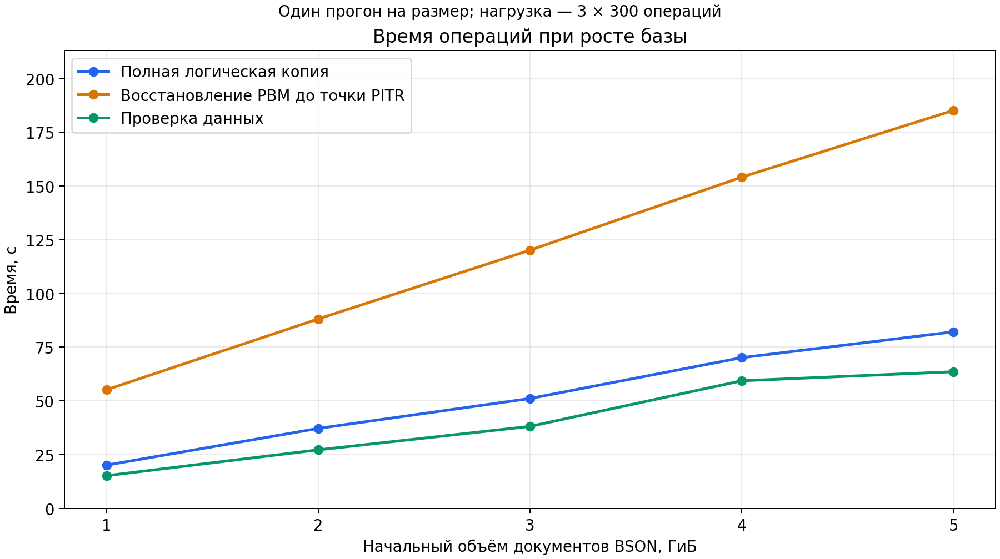
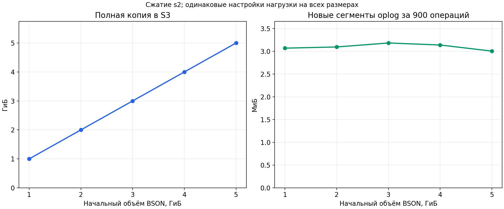
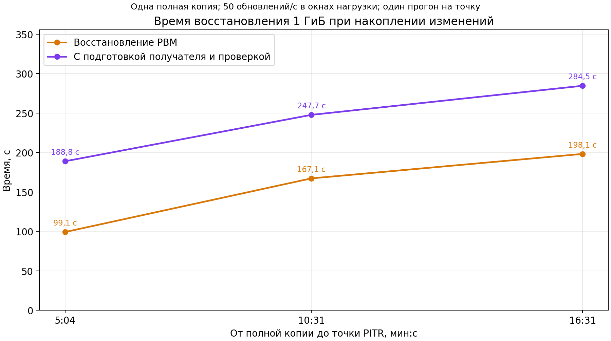

# MongoDB Disaster Recovery с S3

## Кратко о предлагаемом решении

Для организации резервного копирования и аварийного восстановления MongoDB предлагается использовать Percona Backup for MongoDB (PBM) с хранением резервных копий в S3. PBM создаёт полный логический снимок базы данных и регулярно сохраняет сжатые сегменты oplog, содержащие последующие изменения. Это позволяет восстановить данные на отдельном сервере до выбранного момента времени (PITR), даже если исходная MongoDB недоступна.

Для тестирования решения у меня было четыре ВМки, на которых я решила собрать небольшой лабораторный стенд и проверить весь процесс — от создания резервных копий и автоматизации их управления до восстановления MongoDB после отказа исходного сервера. Из-за ограниченных ресурсов пришлось пойти на некоторые компромиссы, поэтому стенд нельзя назвать полностью отказоустойчивым. Тем не менее он позволяет продемонстрировать основные принципы Disaster Recovery на практике. В конце документа я также рассмотрю, как могла бы выглядеть полноценная отказоустойчивая архитектура, если бы ресурсов было больше.

| ВМ | WireGuard | Назначение |
|---|---|---|
| 45.66.12.247, SSD 80 ГБ | 10.23.0.10 | Versity S3 Gateway, бакет `mongo-dr`, префикс `pbm/` |
| 45.66.12.248 / `mongo-01`, NVMe 60 ГБ | 10.23.0.11 | Исходная БД, PBM, генератор и расписание |
| 45.66.12.249 / `mongo-02`, NVMe 60 ГБ | 10.23.0.12 | Чистая БД/PBM для восстановления и Grafana |
| 89.22.231.44 | 10.23.0.13 | Управляющая ВМ, Ansible, Prometheus, Alertmanager, регулярная проверка restore |

На двух ВМ развёрнуты независимые экземпляры MongoDB с одноузловыми replica set. Первая используется как основная база: PBM создаёт её резервные копии и архивирует oplog. Вторая предназначена для проверки восстановления из S3 без подключения к исходному серверу.

Для хранения резервных копий используется отдельная ВМ с Versity S3 Gateway. Взаимодействие между серверами происходит через защищённую сеть WireGuard.

Развёртывание и управление компонентами автоматизированы с помощью Ansible. Проект разделён на три роли: `mongodb` устанавливает и настраивает MongoDB, `s3_storage` подготавливает S3-хранилище, а `pbm` отвечает за резервное копирование и восстановление.

Сеть, WireGuard и SSH-доступ настраиваются заранее. Grafana, Prometheus и Alertmanager уже работают на стенде и не входят в автоматизацию этого проекта.

## С чего начать

Чтобы повторить эксперимент из задания, выполните шаги по порядку:

1. [Подготовьте стенд](#развёртывание-стенда): укажите адреса ВМ и настройте MongoDB, S3 и PBM.
2. [Запустите генератор](#запуск-генератора): создайте тестовые данные, резервную копию и последующие изменения.
3. [Проверьте восстановление](#проверка-восстановления): восстановите данные на другой ВМ и сравните их с ожидаемым состоянием.

Все команды запускайте в терминале **из папки проекта, где лежит `ansible.cfg`**. На этом хосте должен быть установлен Ansible и настроен SSH-доступ к ВМ.

Если вы хотите настроить бэкапы для уже существующей MongoDB своего приложения, используйте [инструкцию интеграции](docs/integration.md).

## Структура проекта

Назначение playbook, требования к запуску и документация каждой роли собраны в [руководстве по Ansible](playbooks/README.md).

```text
inventory/
  hosts.example.yml            SSH-адреса и группы компонентов
  group_vars/all/               параметры эксперимента и профили архивов
  group_vars/mongodb.yml         конфигурация MongoDB
  group_vars/pbm_agents.yml     привязка параметров стенда к роли PBM
  host_vars/                   явные флаги PITR и расписания каждого узла
playbooks/                     сценарии Ansible и роли для настройки стенда, бэкапирования и проверки восстановления
scripts/
  experiment.py                генерация и проверка контрольного набора
  run-drill.py                 запуск учения с блокировкой и метриками результата
  plot-scaling.py              графики по результатам сравнения
  init-secrets.sh              подготовка локальных секретов
examples/
  backup/                      подключение к готовому replica set
  monitoring/                  дашборд и правила для существующего мониторинга
  scheduler/                   пример расписания без инфраструктурной роли
  scaling/                     отдельные экземпляры и серия экспериментов 1–5 ГиБ
images/                        графики измерений, приведённые в README
```

## backup-strategy

После изучения [типов копий PBM](https://docs.percona.com/percona-backup-mongodb/latest/features/backup-types.html) и [методов резервного копирования MongoDB](https://www.mongodb.com/docs/manual/core/backups/) составлены следующие сравнительные таблицы.

### В каком виде сохраняются данные

| Представление | Что сохраняется | Восстановление и особенности |
|---|---|---|
| Логическое | Документы BSON и метаданные коллекций и индексов | Документы загружаются в MongoDB, индексы строятся заново. Можно восстановить отдельную базу или коллекцию. [Документация PBM](https://docs.percona.com/percona-backup-mongodb/latest/features/logical.html) |
| Физическое | Файлы данных и индексов MongoDB | Восстанавливаются файлы базы. На больших наборах это может сократить время восстановления. В PBM требуется совместимый Percona Server for MongoDB. [Документация PBM](https://docs.percona.com/percona-backup-mongodb/latest/features/physical.html) |

### Сколько данных сохраняется при очередном копировании

| Метод | Что сохраняется | Что требуется для восстановления |
|---|---|---|
| Полный | Весь выбранный набор данных | Завершённая полная копия |
| Инкрементный | Изменения после предыдущей копии | Полная основа и вся последующая цепочка инкрементов до нужного состояния |
| Дифференциальный | Все изменения после последней полной копии | Полная основа и одна выбранная дифференциальная копия |


#### Сравнение инструментов резервного копирования

Инструменты сравниваются по требованиям задания: сохранение изменений после начальной копии, отдельное хранение резервных данных и восстановление без работающего источника. Дополнительно учитывается поддержка PITR.

| Инструмент или подход | Что предоставляет | Что потребуется для этого задания |
|---|---|---|
| MongoDB Database Tools — `mongodump` и `mongorestore` | Создание и загрузка логического дампа. `mongodump --oplog` захватывает операции за время выполнения дампа | Отдельно организовать непрерывное архивирование oplog после дампа, проверку отсутствия разрывов, выгрузку в S3, каталог копий и ротацию. [Документация MongoDB](https://www.mongodb.com/docs/manual/tutorial/backup-and-restore-tools/) |
| Percona Backup for MongoDB | Согласованные копии, архивирование oplog, PITR, работа с S3 и команды управления копиями | Установить агенты, настроить права, бакет и расписание. Проверку прикладных данных и внешние уведомления организовать в окружении. [Документация PBM](https://docs.percona.com/percona-backup-mongodb/index.html) |
| Снимки файловой системы или томов | Захват состояния файлов средствами LVM, облачного диска или другой системы хранения | Обеспечить согласованность файлов, поддержку снимков инфраструктурой, независимое хранение и отдельный механизм сохранения последующих операций для PITR. [Документация MongoDB](https://www.mongodb.com/docs/manual/core/backups/) |
| MongoDB Ops Manager | Управление резервным копированием и восстановлением в экосистеме MongoDB | Развернуть и сопровождать Ops Manager, обеспечить условия подписки Enterprise Advanced. Такой контур подходит для проекта, который уже использует эту платформу. [Документация MongoDB](https://www.mongodb.com/docs/manual/core/backups/) |

PBM выбран потому, что предоставляет готовый механизм согласования копии и oplog, каталог доступных точек и восстановление из S3. Это позволяет сосредоточить прототип на Ansible, аварийном сценарии и проверке данных. Его CLI используется для автоматизации, а открытый исходный код позволяет воспроизвести стенд на собственных ВМ. Поддержку S3 задаёт штатная конфигурация PBM.
В проекте Ansible развёртывает службы, systemd запускает ежедневную копию и проверку возраста точки, а `experiment.py` создаёт нагрузку и проверяет данные после восстановления. PBM отвечает за копирование и replay.

На стенде установлен Percona Server for MongoDB, чтобы использовать сервер и PBM из набора пакетов Percona. Выбранная схема логического бэкапирования работает и с поддерживаемой версией MongoDB Community: заменять сервер при подключении PBM к существующему проекту необязательно. [Совместимость PBM с MongoDB](https://docs.percona.com/percona-backup-mongodb/latest/details/versions.html)

### Выбор решения и обоснование

Для прототипа выбрана **полная логическая копия PBM с архивированием oplog**.

- Полная логическая копия сохраняет исходные документы и метаданные. Она подходит для проверки восстановления одной базы на отдельной ВМ.
- Между полными копиями агент PBM сохраняет последовательные сегменты oplog. Это выполняет требование сохранять последующие изменения без нового полного копирования при каждом цикле эксперимента.
- При PITR PBM загружает подходящую копию и воспроизводит операции до выбранного времени. Для этого нужны завершённая копия, её метаданные и непрерывный oplog до цели. Доступные интервалы показывает `pbm list`. [PITR в PBM](https://docs.percona.com/percona-backup-mongodb/latest/features/point-in-time-recovery.html)
- Отдельный S3-сервер хранит копии независимо от исходной MongoDB.

MongoDB работает во время создания копии. Полный снимок создаётся ежедневно, сегменты oplog выгружаются примерно раз в минуту. Во время эксперимента после начального снимка измеряется объём новых сегментов.


### Хранение и ротация

Параметры расписания, нарезки oplog и хранения имеют [значения по умолчанию в роли PBM](playbooks/roles/pbm/defaults/main.yml). Архивы S3 задаются в [профилях хранения](inventory/group_vars/all/s3.yml), настройки узлов — в `inventory/host_vars/`.

После успешного ежедневного полного снимка запускается `pbm cleanup`. Срок хранения задаётся переменной `pbm_retention_days`, по умолчанию — 7 дней. [Очистка PBM](https://docs.percona.com/percona-backup-mongodb/usage/schedule-backup.html)

## incremental-backup-and-restore

### Развёртывание стенда

Проект работает с заранее подготовленными ВМ. Их создание можно автоматизировать отдельным Terraform-модулем для выбранного провайдера. Настройка инфраструктуры отделена от модуля резервного копирования.

Для проверки решения нужны исходная MongoDB с replica set, отдельное хранилище резервных копий и чистое окружение для восстановления. Можно использовать существующие MongoDB и S3 по [инструкции интеграции](docs/integration.md).

Ниже описано развёртывание нашей лаборатории: две ВМ с независимыми MongoDB и одна ВМ с S3 Gateway. Для автоматической установки подготовьте Ubuntu 24.04 amd64 с Python 3, рабочим SSH и синхронизированным временем. Это окружение, на которое рассчитаны установочные роли проекта.

Узлы MongoDB должны иметь доступ к S3. В лаборатории HTTP-трафик защищён заранее настроенным WireGuard; можно использовать другую защищённую сеть. Для внешнего S3 используйте HTTPS. На Ansible-контроллере нужны Ansible Core 2.19+ и OpenSSL.

Все следующие команды выполняются **на Ansible-контроллере из корня проекта**.

```bash
# Создать рабочий inventory из образца; -n сохраняет существующий файл.
cp -n inventory/hosts.example.yml inventory/hosts.yml
# Сгенерировать недостающие секреты с правами 0600; прежние значения сохраняются.
bash scripts/init-secrets.sh
```

Перед запуском Ansible проверьте настройки:

| Файл | Что указать |
|---|---|
| `inventory/hosts.yml` | SSH-адреса, пользователя и при необходимости порт и путь к приватному ключу |
| `inventory/group_vars/all/s3.yml` | Адрес S3 и адрес прослушивания gateway |
| `inventory/host_vars/` | На источнике включить `pbm_pitr_enabled` и `pbm_schedule_enabled`, на получателе — выключить |

```bash
# Проверить SSH и запуск Python-модулей на ВМ из inventory.
ansible all -m ping
# Установить MongoDB, лабораторное S3 и PBM. Эта команда не восстанавливает данные.
ansible-playbook playbooks/setup.yml
```

Подробные параметры ролей, их действия и варианты запуска описаны в [руководстве по Ansible](playbooks/README.md).

### Полный снимок и последующие изменения

Начальную полную копию контрольных данных создаёт `experiment.yml` при [запуске эксперимента](#запуск-генератора). Отдельно запускать `backup.yml` перед экспериментом не требуется. Между полными копиями `pbm-agent` самостоятельно выгружает сегменты oplog, поэтому каждый цикл изменений не создаёт нового полного дампа.

Команда для самостоятельного ручного бэкапа описана в [руководстве по Ansible](playbooks/README.md#playbook-и-место-выполнения).

| Действие | Где выполняется |
|---|---|
| Полный снимок, в том числе ежедневный в 05:15 МСК (02:15 UTC) | `mongo-01` → S3 |
| Сегменты oplog, `pitr.enabled: true`, `oplogSpanMin: 1` | `mongo-01` → S3 |
| Импорт каталога и PITR | Выбранный `restore_target` читает указанный архив S3 |
| Генерация и проверка контрольных данных | Генерация — на исходной ВМ, проверка — на ВМ восстановления. Отчёты сохраняются в artifacts/ на Ansible-контроллере |

Для ручной диагностики **на соответствующей MongoDB ВМ**:

```bash
# Подставить локальный URI из защищённого pbm.env и показать состояние агентов.
sudo /srv/mongo-dr/drctl pbm status
# Показать полные копии и доступные диапазоны PITR.
sudo /srv/mongo-dr/drctl pbm list
# Показать последние ошибки PBM.
sudo /srv/mongo-dr/drctl pbm logs --severity=E --tail=20
```

### Проверка восстановления

Проверяем, что из S3 можно восстановить тестовую базу на ВМ `mongo-02` (.249) и получить ожидаемые данные. На ней должны быть установлены MongoDB и PBM, а PITR и расписание копий — выключены. Для лаборатории это настраивает `setup.yml`.

**1. Выполните [эксперимент](#запуск-генератора).** Он создаст данные на источнике, сохранит полную копию и последующие изменения в S3. На Ansible-контроллере появится `artifacts/experiment.json`: в нём записаны имя тестовой базы, время для восстановления, ожидаемые количество документов, контрольная сумма и индексы. Сами резервные данные хранятся в S3.

**2. Запустите восстановление на том же Ansible-контроллере из корня проекта:**

```bash
# Восстановить тестовую базу на mongo-02 из S3 и проверить результат.
ansible-playbook playbooks/restore.yml \
  -e restore_target=mongo-02 \
  -e restore_confirm=mongo-02 \
  -e restore_archive=lab \
  -e restore_manifest=artifacts/experiment.json
```

Каждый `-e` передаёт параметр запуска:

| Параметр | Значение в этой команде |
|---|---|
| `restore_target` | Восстановить на хосте `mongo-02` |
| `restore_confirm` | Подтвердить, что данные восстанавливаем именно на `mongo-02`; выбранные данные на ней будут перезаписаны |
| `restore_archive` | Использовать хранилище `lab`, описанное в `backup_archives` — в лаборатории это S3 на .247 |
| `restore_manifest` | Взять время восстановления и ожидаемые данные из отчёта эксперимента |

PBM на `mongo-02` загрузит копию из S3 и применит изменения до времени из отчёта. Затем скрипт автоматически сравнит восстановленные данные с ожидаемыми. Исходная ВМ для этого не нужна. При несовпадении проверка завершится ошибкой.

**3. После успешного выполнения посмотрите отчёт на контроллере:**

```bash
# Показать, куда и до какого времени восстановлена база, длительность и результат проверки.
cat artifacts/restore.json
```

В отчёте `restore_success: true` означает, что команда PBM восстановила данные, а `success: true` — что весь запрошенный сценарий завершился успешно. При переданном отчёте эксперимента также должны быть `verification_status: passed` и в разделе `verification` — `valid: true` и `after_target_absent: true`: данные совпали, запись после выбранного времени отсутствует.

При ошибке начатого восстановления отчёт тоже сохраняется: `failed_stage` указывает этап сбоя. Рядом создаётся `artifacts/restore.prom` — метрики для уведомлений. Без проверки данных статус равен `not_requested`; успешная команда PBM сама по себе не считается проверкой целостности.

Подготовка полностью пустого получателя описана в [руководстве по Ansible](playbooks/README.md#подготовка-пустого-получателя).

### Обработка ошибок

Ошибки PBM и проверки целостности возвращают ненулевой код Ansible. Таймаут ожидания PITR не считается успешным бэкапом. Обёртка полного снимка отдельно фиксирует ошибку копирования или очистки в `state/backup.json`.

Если эксперимент приостановил ранее активный таймер снимков, блок `always` возвращает его после завершения. В сценарии остановки источника службы запускаются обратно через `always`. При потере SSH или прерывании самого Ansible проверьте службы вручную. При неуспешном restore получатель не считается готовым к переключению приложения.

### Уведомления в Telegram

На стенде сообщения отправляет Alertmanager. Программы бэкапирования и проверочного восстановления записывают результат в метрики, Prometheus обнаруживает ошибку, а Alertmanager отправляет сообщение Telegram-ботом.

| Что контролируется | Условие срабатывания | Правило |
|---|---|---|
| Успешность резервного копирования и очистки | Зафиксирована ошибка создания полной копии или удаления устаревших копий | `BackupFailed` |
| Результат отдельного восстановления | Ошибка подготовки, импорта каталога, восстановления или проверки данных | `RestoreFailed` |
| Завершение восстановления | Начатое восстановление не записало итоговый результат за 4 часа 10 минут | `RestoreStuck` |
| Полный проверочный сценарий | Учение завершилось ошибкой на любом этапе | `RestoreDrillFailed` |
| Свежесть полной копии | Последняя успешная полная копия старше 26 часов | `FullBackupTooOld` |
| Свежесть изменений для PITR | Последняя доступная точка восстановления отстаёт более чем на 180 секунд | `PITRBehind` |
| Регулярность проверки восстановления | Нет успешного учения более 8 дней или отсутствуют его метрики | `RestoreDrillTooOld` |

Реализация условий и задержки перед отправкой события заданы в [правилах Prometheus](examples/monitoring/rules.yml).

Настройка канала и тестового сообщения описана в [примере мониторинга](examples/monitoring/README.md). Prometheus и Alertmanager готовятся отдельно от трёх ролей задания.

## synthetic-data-generator

Генератор находится в [scripts/experiment.py](scripts/experiment.py), отдельно от роли MongoDB. Режим `run` создаёт коллекцию `events` с тестовыми бинарными данными заданного размера и индексом `project`, выполняет вставки/изменения/удаления и записывает контрольные точки. `verify` проверяет восстановленный набор. Поле `payload` заполняется псевдослучайными байтами.

### Параметры нагрузки

`-e` передаёт переменные Ansible текущему запуску. Например, `-e experiment_docs=262144` задаёт число исходных документов.

| Переменная | Значение |
|---|---|
| `experiment_host` | Один хост, где выполняются генерация и бэкап; по умолчанию `mongo-01` |
| `experiment_db` | Новое имя синтетической базы с префиксом `dr_` |
| `experiment_docs` | Число исходных документов |
| `experiment_target_gib` | Целевой объём BSON в ГиБ; при значении больше нуля заменяет ограничение по числу документов |
| `experiment_payload` | Средняя длина payload в байтах; фактическая 50–150% |
| `experiment_seed` | Seed; по умолчанию 42 |
| `experiment_rate` | Целевое число операций в секунду |
| `experiment_duration`, `experiment_cycles` | Длительность окна и число окон изменений |
| `experiment_weights` | Веса insert/update/delete, например `[25,60,15]` |
| `experiment_report_path` | Путь к отчёту на контроллере; по умолчанию `artifacts/experiment.json` |

Фиксированные seed и параметры дают сопоставимые данные и последовательность операций. Фактический темп зависит от ресурсов. Полный снимок включает все базы экземпляра, в том числе оставшиеся от прошлых экспериментов.

### Запуск генератора

```bash
ansible-playbook playbooks/experiment.yml -e \
 '{"experiment_host":"mongo-01","experiment_db":"dr_trial_02","experiment_docs":262144,"experiment_payload":4096,"experiment_rate":5,"experiment_duration":60,"experiment_cycles":3,"experiment_weights":[25,60,15]}'
```

Генератор на `mongo-01` формирует около 1 ГиБ и сохраняет полный снимок в S3. Затем три раза изменяет данные: по 5 операций в секунду в течение минуты, всего 900 операций. После каждого цикла он дожидается сохранения изменений в S3. В конце добавляет контрольный документ, который не должен попасть в восстановление на выбранный момент. Playbook сохраняет отчёт на контроллере в `artifacts/experiment.json`.

`ASYNC POLL` — сообщения Ansible о проверке состояния долгой команды на удалённой ВМ. Они не являются отдельными командами MongoDB. `ASYNC OK` означает, что команда закончилась успешно.

### Практические результаты и проверка корректности

Перед каждым прогоном тестовая БД создавалась заново, получатель перед восстановлением был пустым. Для всех размеров — три цикла по 300 операций: 5 операций/с в течение минуты, веса insert/update/delete — 25/60/15.

| Начальная БД, ГиБ BSON | Полная копия, с | PITR PBM, с | Проверка, с | Новые сегменты в S3, МиБ |
|---:|---:|---:|---:|---:|
| 1 | 20,08 | 55,15 | 15,17 | 3,07 |
| 2 | 37,16 | 88,11 | 27,18 | 3,10 |
| 3 | 51,08 | 120,13 | 38,11 | 3,18 |
| 4 | 70,08 | 154,12 | 59,33 | 3,14 |
| 5 | 82,11 | 185,18 | 63,54 | 3,00 |



При росте базы с 1 до 5 ГиБ создание полной копии заняло от 20 до 82 секунд, восстановление PITR — от 55 до 185 секунд. Для 5 ГиБ восстановление вместе с подготовкой получателя и проверкой данных заняло 4 минуты 54 секунды.



Объём полной копии растёт вместе с базой, а одинаковая нагрузка в 900 операций добавила около 3–3,2 МиБ сегментов oplog на каждом размере.

## disaster-recovery

Для оценки восстановления ниже приведены фактические замеры стенда. Целевые RPO и RTO для приложения нужно определить отдельно по допустимой потере данных и длительности простоя; результаты одного прогона не задают эти требования.

### Измеренное время восстановления

Для каждого размера выполнен один прогон на отдельном получателе; резервная копия и изменения уже находились в S3.

| Начальный объём БД, ГиБ BSON | Восстановление с подготовкой получателя и проверкой данных |
|---:|---:|
| 1 | 1 мин 55 с |
| 2 | 2 мин 39 с |
| 3 | 3 мин 21 с |
| 4 | 4 мин 13 с |
| 5 | 4 мин 54 с |

Время включает подготовку пустого экземпляра MongoDB, импорт каталога S3, PITR и проверку данных. ВМ и пакеты MongoDB/PBM были подготовлены заранее. Обнаружение аварии, создание новой ВМ, установка ПО и переключение приложения не измерялись, поэтому таблица не показывает полный RTO приложения.

Во всех пяти прогонах прошли `validate(full=true)` и сравнение количества документов, объёма BSON, SHA-256 и имён индексов. Контрольный документ, добавленный после выбранного времени, отсутствовал: PITR восстановил ожидаемое состояние.

Фактическая потеря последних данных при внезапном отказе источника в этой серии не измерялась. Настройка минутных сегментов oplog и порог уведомления об отставании PITR в 180 секунд сами по себе не подтверждают RPO до 3 минут. Для проверки RPO нужно отдельно сопоставить момент отказа и последнюю восстановимую запись, сохранённую в S3.

### Влияние накопленных изменений на время восстановления

Для базы 1 ГиБ создана одна полная копия, затем выполнены три пятиминутных окна по 50 обновлений/с. Число документов осталось неизменным. Каждая точка восстановлена на пустом получателе; совпали SHA-256, число документов и имена индексов, прошла проверка `validate`.

| От полной копии до точки, мин:с | Накоплено обновлений | Сегменты oplog в S3, МиБ | PITR PBM, с | С подготовкой и проверкой |
|---:|---:|---:|---:|---:|
| 5:04 | 15000 | 60,11 | 99,13 | 3 мин 09 с |
| 10:31 | 30000 | 120,14 | 167,12 | 4 мин 08 с |
| 16:31 | 45000 | 180,45 | 198,14 | 4 мин 45 с |



При росте накопленного журнала с 15 000 до 45 000 обновлений время PBM выросло с 99 до 198 секунд, хотя исходная полная копия и число документов одинаковы. Влияет объём изменений после копии, а не только размер базы.

### Аварийные сценарии

**DR (Disaster Recovery)** — аварийное восстановление системы после сбоя. В лаборатории `mongo-02` — отдельный сервер, на который восстанавливаются данные из резервных копий.

| Сценарий | Действия |
|---|---|
| Потеря доступа к БД | Проверить SSH, сеть и состояние `mongod`. При подтверждённой аварии восстановить данные на `mongo-02` |
| Ошибочное удаление или повреждение данных | Найти момент до ошибки в диапазоне PITR, восстановить выбранную базу |
| Потеря исходной ВМ | Подготовить MongoDB на отдельной ВМ, импортировать каталог S3, восстановить без соединения с исходной БД |
| Временная недоступность S3 | Вернуть доступ до вытеснения нужного локального oplog, следить за отставанием доступной точки |
| Потеря S3 ВМ или её диска | Восстановить доступ к диску. Если диск утрачен, а исходная БД доступна — подготовить новое хранилище и создать полную копию. При одновременной потере БД и архива восстановление без независимой копии невозможно |

**Ограничения тестового стенда.** Архив хранится на единственной S3-ВМ `45.66.12.247`; независимой копии в другом хранилище нет. Потеря её диска означает потерю архива. Источник и получатель — независимые одноузловые replica set; автоматического переключения приложения между ними нет.

Для рабочего решения следует хранить независимую копию архива в другом S3-хранилище или ЦОД с отдельными правами доступа. Несколько бакетов на одной ВМ не защищают от потери этой ВМ. Для PITR во второй копии нужны полный снимок, метаданные и непрерывный oplog до выбранного времени; её пригодность проверяется восстановлением. Автоматическое дублирование архива во второе S3 в этом проекте не реализовано. [Несколько хранилищ в PBM](https://docs.percona.com/percona-backup-mongodb/2.17.0/features/multi-storage.html).

Восстановление до нужного времени требует целой цепочки. Потеря снимка, нужного сегмента, учётных данных или выход цели за доступный диапазон ограничивают восстановление.

### Пошаговое восстановление

Ниже приведены команды для существующего стенда: тестовая база `dr_scheduled_check`, сервер восстановления `mongo-02`. Команды Ansible выполняются на управляющей ВМ из `/opt/mongo-dr-lab`.

1. Подключитесь к управляющей ВМ:

   ```bash
   ssh root@89.22.231.44
   cd /opt/mongo-dr-lab
   ```

   На `mongo-02` должны работать MongoDB и PBM, а архив S3 должен быть доступен. Если эти компоненты уже настроены, повторно запускать роли `mongodb` и `s3_storage` не требуется.

2. Импортируйте каталог архива на `mongo-02` и посмотрите доступные точки:

   ```bash
   # Показать доступные снимки и диапазоны выбранного архива на mongo-02.
   ansible-playbook playbooks/restore.yml -e \
    '{"restore_target":"mongo-02","restore_confirm":"mongo-02","restore_archive":"lab","restore_list_only":true}'
   ```

3. Восстановление.


   ```bash
   ansible-playbook playbooks/restore.yml -e \
    '{"restore_target":"mongo-02","restore_confirm":"mongo-02","restore_archive":"lab","restore_database":"dr_scheduled_check","restore_time":"2026-11-22T19:51:10"}'
   ```

   Время должно попадать в доступный диапазон PITR, а база — присутствовать в архиве. При ошибочном удалении выбирайте точку до ошибки, а не последнюю. Операция перезаписывает выбранную базу на `mongo-02`; исходная `mongo-01` не изменяется. В этом варианте контрольный набор для выбранного времени не передаётся, поэтому автоматическое сравнение данных не выполняется.

   **На контрольную точку эксперимента с автоматической проверкой.** Для проверки лаборатории используйте вместо команды выше:

   ```bash
   # На том же контроллере из корня проекта: восстановить точку эксперимента
   # и автоматически сравнить данные с сохранённым манифестом.
   ansible-playbook playbooks/restore.yml -e \
    '{"restore_target":"mongo-02","restore_confirm":"mongo-02","restore_archive":"lab","restore_manifest":"artifacts/experiment.json"}'
   ```

   Имя базы и время берутся из `artifacts/experiment.json`, созданного предыдущим запуском `experiment.yml` или учением на этом контроллере. Это контрольная точка эксперимента, которая может быть раньше последней доступной точки PITR. Архив должен содержать соответствующую копию и oplog. Playbook сам проверяет количество документов, объём BSON, SHA-256, имена индексов, `validate` и отсутствие контрольной записи после выбранного времени. При несовпадении команда завершается ошибкой.

4. Результат восстановления сохраняется на контроллере. Проверять документы вручную после запуска с манифестом не требуется; при необходимости подробности можно посмотреть командой:

   ```bash
   cat artifacts/restore.json
   ```

   Для лабораторного набора успешный итог — `success: true` и `verification_status: passed`. При восстановлении своей базы без манифеста проверка данных не запускается: статус равен `not_requested`. 

   
### Повторяемое учение

```bash
# На контроллере: свежий небольшой набор → снимок → изменения → чистый
# выбранный получатель → PITR → SHA-256/индексы/validate.
ansible-playbook playbooks/drill.yml
# То же учение с блокировкой повторного запуска и метриками результата.
python3 scripts/run-drill.py
```

Хосты задают `experiment_host` и `drill_target`, архив — `drill_archive`. Выделенная база `dr_scheduled_check` пересоздаётся при повторе; данные приложения в ней размещать нельзя. После успешной проверки сохраняется один предыдущий каталог автоматических учений `drill-previous-*`. Ручные каталоги `data-before-*` не очищаются. Отчёты: `artifacts/drill.json`, `artifacts/drill.prom`, `artifacts/restore.json`.

```bash
# Отдельная имитация отказа: после подготовки контрольной точки остановить
# источник, восстановить на получателе и вернуть службы источника обратно.
ansible-playbook playbooks/drill.yml -e restore_stop_source=true
```

Этот режим требует доступного источника для самой имитации. Настоящее аварийное восстановление выполняется `restore.yml` с `restore_stop_source=false` по умолчанию и не подключается к источнику. Для регулярного запуска используйте свой CI/cron или [пример systemd-таймера](examples/scheduler/README.md).

## Будет плюсом

| Пункт задания | Реализация |
|---|---|
| PITR | PBM, полный логический снимок и непрерывный архив oplog; измерения приведены выше |
| Автоматическая целостность | Манифест, SHA-256, количество документов, индексы и `validate` |
| Регулярное восстановление | `drill.yml`, runner с блокировкой и [пример расписания](examples/scheduler/README.md) |
| Метрики результата, времени, объёма | PBM JSON/textfile и отчёты эксперимента; установка сервера мониторинга внешняя |
| Уведомления | [Telegram через Prometheus и Alertmanager](#уведомления-в-telegram): ошибки бэкапа, отдельного восстановления и полного учения |
| Ротация | `pbm cleanup` после успешной копии, настраиваемый `pbm_retention_days` |
| Потеря ЦОД | Описана независимая копия архива; второй контур фактически не развёрнут |


### Вариант развития отказоустойчивой архитектуры

Для рабочего приложения стенд можно развить дальше: разнести три узла MongoDB replica set по независимым зонам или дата-центрам, хранить вторую копию архива S3 в другом регионе и подготовить отдельное окружение для аварийного восстановления. Если один узел выйдет из строя, два оставшихся смогут продолжить работу при доступной связи и наличии актуальных данных. Если же кто-то случайно удалит данные, восстановить состояние до ошибки поможет PITR.

Такую архитектуру можно развернуть и в Kubernetes. При этом узлы MongoDB нужно распределить по разным ВМ и зонам отказа: три Pod на одной ВМ не защитят от её потери. Резервные копии стоит хранить за пределами этого кластера, чтобы они оставались доступны при его отказе.

